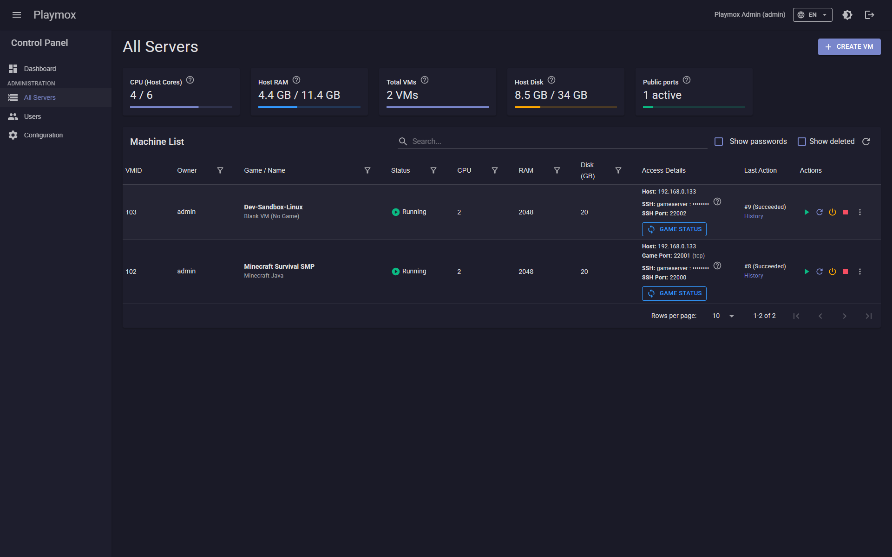
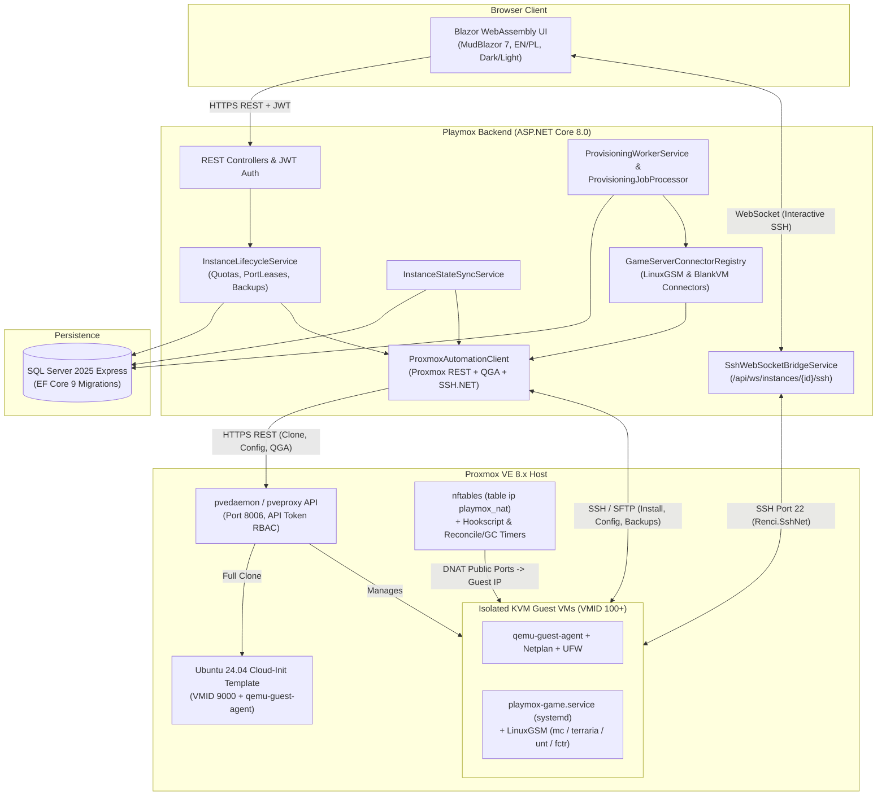
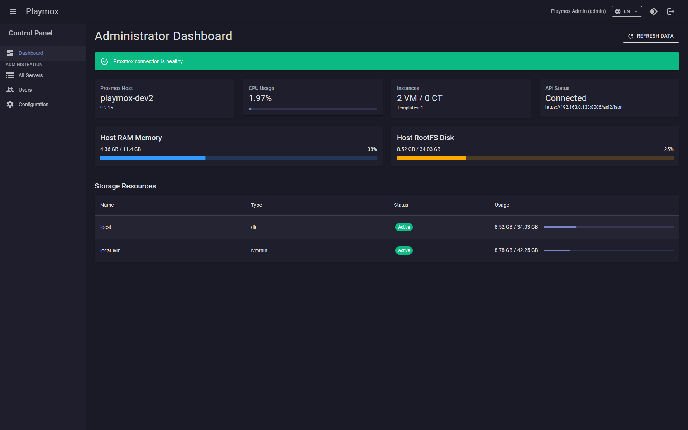
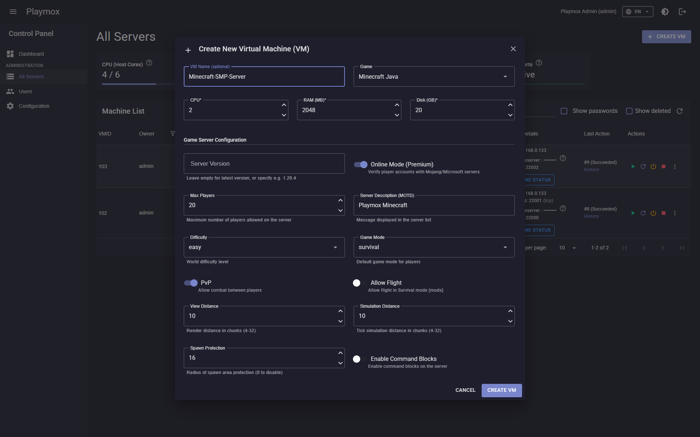
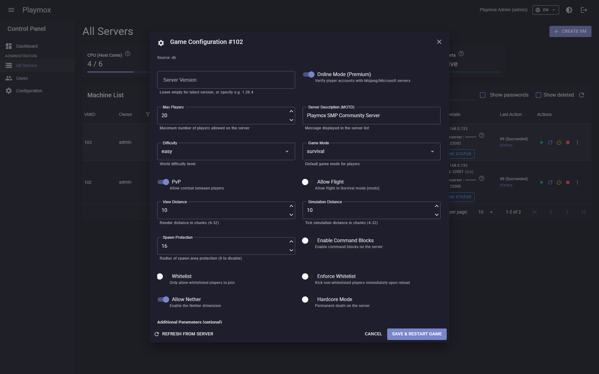
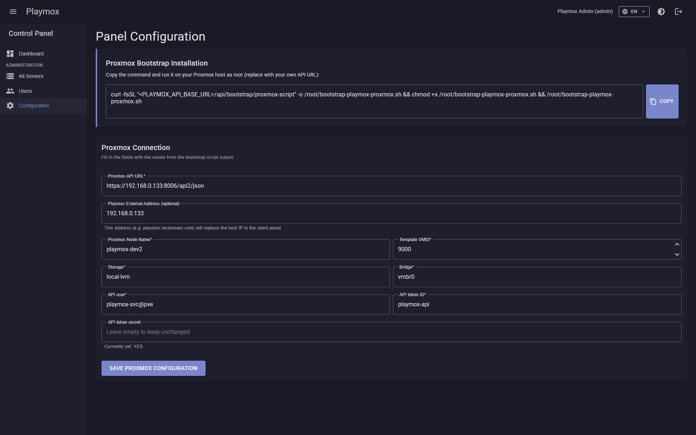
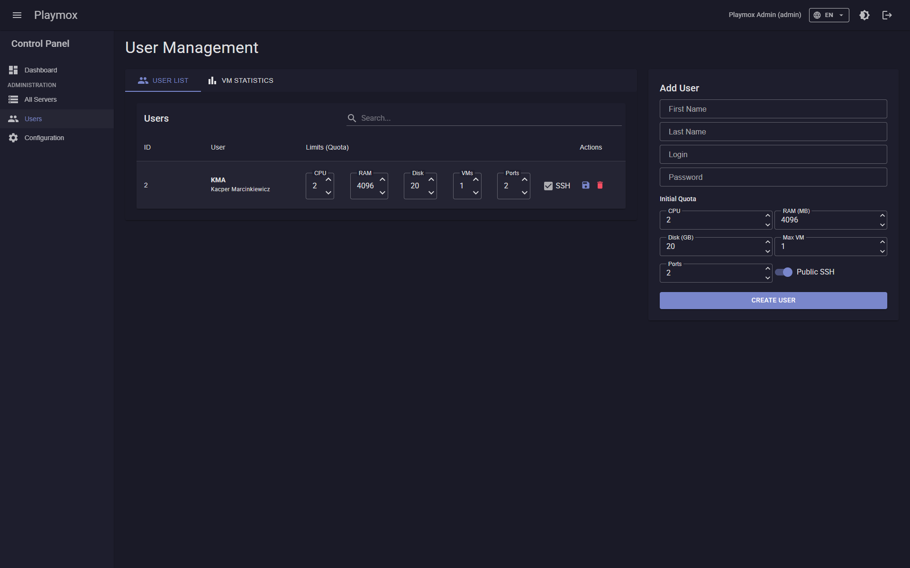

# Playmox

**Self-Hosted Multi-Tenant Game Server Provisioning & Management Platform for Proxmox VE**

[](https://dotnet.microsoft.com/en-us/download/dotnet/8.0)
[](https://dotnet.microsoft.com/en-us/apps/aspnet/web-apps/blazor)
[](https://www.proxmox.com/en/proxmox-virtual-environment)
[](https://linuxgsm.com/)
[](https://docs.docker.com/compose/)
[](LICENSE)



---

> [!NOTE]
> **Engineering Thesis Project Disclaimer**: Playmox was originally created and developed as an academic engineering thesis. While the core features are fully functional and tested, the platform is not 100% complete or production-hardened and requires further community refinement and testing.
>
> **AI-Assisted Documentation**: All technical documentation, architectural guides, and codebase specifications have been authored and organized with the assistance of AI to accelerate onboarding and facilitate future open-source development and contributions.

---

## Overview

**Playmox** is an open-source, self-hosted control plane that transforms a **Proxmox Virtual Environment (Proxmox VE)** host into a multi-tenant game server cloud. Rather than giving players or sub-administrators direct access to the Proxmox web UI or hypervisor API, Playmox provides a clean, quota-governed self-service portal where users can spin up isolated KVM virtual machines, automatically install and configure dedicated game servers via **LinuxGSM**, stream real-time installation logs, manage backups, and access an in-browser WebSocket SSH terminal.

### Key Features

- **Automated KVM Virtual Machine Provisioning**: Clones pre-hardened Ubuntu 24.04 LTS Cloud-Init templates (`VMID 9000`), injects dynamic `cloud-init` credentials (`gameserver`), discovers internal IPv4 leases via QEMU Guest Agent (QGA), and automatically converts DHCP leases into static Netplan configurations so internal IPs never drift across reboots.
- **Built-In LinuxGSM Game Server Connectors**:
  - **Minecraft Java Edition** (`mcserver`) — automatic JDK provisioning (Java 8 / 17 / 21 matched to server version), `server.properties` synchronization, and dynamic JVM `-Xmx` heap scaling when VM RAM is resized.
  - **Terraria** (`terrariaserver`) — world auto-creation, size/seed configuration, and `serverconfig.txt` management.
  - **Unturned** (`untserver`) — dual-port (`27015`–`27016` TCP/UDP) forwarding, `Commands.dat` + `Config.json` generation, and SteamCMD integration.
  - **Factorio** (`fctrserver`) — headless server provisioning, initial map save generation, and `server-settings.json` management via `jq`.
  - **Blank VM Mode** (`blank-vm`) — pure Ubuntu 24.04 KVM virtual machine without any game server pre-installed, plus an extensible `IGameServerConnector` SDK for adding new games.
- **Multi-Tenant Resource Quotas**: Per-user limits for **CPU cores**, **RAM (MB)**, **Disk (GB)**, **Max Instances**, **Public Ports**, and **Public SSH Access**. Stopped virtual machines only consume **Disk** quota—freeing CPU, RAM, instance slots, and public port capacity for other active workloads until restarted.
- **Automated Proxmox Host DNAT Port Forwarding & Firewall Hardening**:
  - Allocates collision-free public ports (`22000`–`32000`) persisted in SQL Server (`PortLeases`).
  - Encodes port-forwarding rules in the Proxmox VM description (`playmox-dnat:ssh=...;gameStart=...;gameCount=...;proto=...`) and synchronizes them to the Proxmox host's `nftables` (`table ip playmox_nat`) via VM lifecycle hookscripts, a 15-second reconciliation timer, and an orphan garbage-collection timer.
  - Automatically configures guest VM `ufw` firewall rules to allow only SSH (`22/tcp`) and the allocated game server ports.
- **Dynamic JSON Schema Game Configuration**: Each game definition stores a JSON Schema that dynamically renders type-safe UI forms in Blazor. Users can load configuration snapshots from the database or live-sync directly from config files on the running guest VM, plus inject arbitrary `customParameters` (`key=value`, space-separated, or JSON).
- **One-Click Backups & Restore**: Package world saves and server configuration files into a `.tar.gz` archive streamed over SFTP to the browser, or upload an existing `.tar.gz` backup (up to 500 MB) to restore an instance with automatic service stop/restart.
- **In-Browser WebSocket SSH Terminal & Live Installation Stream**:
  - Interactive browser SSH console powered by `SshWebSocketBridgeService` (`Renci.SshNet` shell stream over WebSocket) with zero external terminal proxies required.
  - Live command output streaming during game server installation and updates, including real-time **Steam Guard Mobile Authenticator** prompt detection.

---

## Architecture



---

## Screenshots

| Dashboard & Quota Telemetry | Virtual Machine Instances |
| :---: | :---: |
|  |  |
| **Create Instance & Dynamic Parameters** | **Live Game Configuration Editor** |
|  |  |
| **Panel Configuration** | **Administrator User & Quota Management** |
|  |  |

---

## Quick Start Guide

### Prerequisites

- **Proxmox VE 8.x** host with hardware virtualization (KVM) enabled, internet connectivity, and `root` shell access.
- **Docker** and **Docker Compose v2** installed on the machine hosting the Playmox stack (can be a dedicated management VM, LXC container, or external server reachable by the Proxmox host).

### Step 1: Bootstrap the Proxmox VE Host

Playmox ships with an idempotent setup script (`API/Bootstrap/bootstrap-playmox-proxmox.sh`) that automates the entire Proxmox host configuration in a single run:
1. Creates a least-privilege RBAC role (`PlaymoxProvisioner`), service account (`playmox-svc@pve`), and API token (`playmox-api`).
2. Downloads the official **Ubuntu 24.04 LTS Cloud Image**, injects `qemu-guest-agent`, cleans `machine-id` to prevent DHCP collisions, and builds the Cloud-Init template (`VMID 9000`).
3. Configures `nftables` DNAT port-forwarding scripts (`/usr/local/sbin/playmox-dnat-sync.sh`), VM hookscript (`local:snippets/playmox-dnat-hook.sh`), and systemd reconciliation/garbage-collection timers (`playmox-dnat-reconcile.timer`, `playmox-dnat-gc.timer`).

Run the script as `root` on your Proxmox VE host:

```bash
# Option A: If the Playmox API container is already running, fetch directly from the API:
curl -fsSL "http://<PLAYMOX_API_HOST>:8080/api/bootstrap/proxmox-script" -o /root/bootstrap-playmox-proxmox.sh
chmod +x /root/bootstrap-playmox-proxmox.sh
/root/bootstrap-playmox-proxmox.sh

# Option B: Copy API/Bootstrap/bootstrap-playmox-proxmox.sh from this repository to Proxmox and run:
chmod +x ./bootstrap-playmox-proxmox.sh
./bootstrap-playmox-proxmox.sh
```

At the end of execution, copy the generated output block (`PROXMOX_URL`, `PROXMOX_NODE`, `PROXMOX_API_USER`, `PROXMOX_API_TOKEN_ID`, `PROXMOX_API_TOKEN_SECRET`, `PROXMOX_TEMPLATE_VMID`, `PROXMOX_STORAGE`, `PROXMOX_BRIDGE`).

### Step 2: Run the Playmox Stack with Docker Compose

Clone the repository, configure your `.env` file, and launch the stack (`playmox-db`, `playmox-api`, `playmox-frontend`):

```bash
git clone https://github.com/Kacper1263/playmox-platform.git
cd playmox-platform

cp .env.example .env
# Edit .env and set strong values for DB_SA_PASSWORD, BOOTSTRAP_ADMIN_PASSWORD, PASSWORD_SALT, and APP_SECRET
```

Start the containers:

```bash
docker compose up -d --build
```

On startup, `playmox-api` automatically applies all Entity Framework Core migrations (`Database.Migrate()`) and seeds the default roles (`Admin`, `User`), the bootstrap administrator account, and the built-in game catalog (`blank-vm`, `minecraft-java`, `terraria`, `unturned`, `factorio`).

Default service endpoints:
- **Playmox Web UI (Blazor WASM)**: `http://localhost:8081`
- **Playmox REST API & Swagger UI**: `http://localhost:8080/swagger`
- **SQL Server 2025 Express**: `localhost:1433`

### Step 3: Connect Playmox to Proxmox VE

1. Open the Playmox Web UI at `http://localhost:8081` and sign in using the administrator credentials configured in `.env` (`BOOTSTRAP_ADMIN_LOGIN` / `BOOTSTRAP_ADMIN_PASSWORD`).
2. Navigate to **Configuration** (`/configuration`) in the top navigation bar.
3. Paste the connection parameters printed by `bootstrap-playmox-proxmox.sh` into the **Proxmox Connection Settings** form and click **Save**.
4. (Optional) Configure your **External Address** (public IPv4 or domain name of your Proxmox host) so players receive ready-to-copy public connection strings on their instance cards.
5. Navigate to **Instances** (`/instances`) and click **Create Instance** to provision your first game server!

---

## Adding a New Game Server Connector

Playmox uses a modular connector architecture (`IGameServerConnector` & `LinuxGsmConnectorBase` in `API/Services/Platform/Games/`) paired with JSON Schema definitions in `BootstrapDataSeeder.cs`. Adding support for a new LinuxGSM or custom dedicated server requires:

1. Adding an enum value to `GameServerKind` and mapping its key in `GameServerKindResolver`.
2. Implementing a connector class deriving from `LinuxGsmConnectorBase` (or `IGameServerConnector`).
3. Registering the connector in `Program.cs` Dependency Injection.
4. Adding the game catalog entry and JSON Schema in `BootstrapDataSeeder.cs`.
5. Adding optional localized schema field labels (`schema.<fieldKey>.title` and `schema.<fieldKey>.desc`) in `Frontend/PlaymoxWeb/wwwroot/locales/en.json` and `pl.json`.

See the complete step-by-step developer guide in **[docs/12-adding-new-game-connectors.md](docs/12-adding-new-game-connectors.md)**.

---

## Documentation Index

All architectural, operational, and developer documentation is located in the [`docs/`](docs/README.md) directory:

| Document | Description |
| :--- | :--- |
| **[docs/README.md](docs/README.md)** | Documentation table of contents and reading order. |
| **[docs/01-overview.md](docs/01-overview.md)** | Platform vision, user vs. administrator capabilities, and VM lifecycle overview. |
| **[docs/02-architecture.md](docs/02-architecture.md)** | System architecture, dual-lane job processor, state sync, and WebSocket SSH bridge. |
| **[docs/03-tech-stack.md](docs/03-tech-stack.md)** | Full technology stack breakdown (.NET 8, EF Core 9, SQL Server 2025, MudBlazor 7, SSH.NET, Proxmox VE). |
| **[docs/04-proxmox-provisioning.md](docs/04-proxmox-provisioning.md)** | Template cloning (`VMID 9000`), Cloud-Init, QGA discovery, static Netplan IP pinning, and UFW hardening. |
| **[docs/05-game-automation-linuxgsm.md](docs/05-game-automation-linuxgsm.md)** | LinuxGSM automation, `playmox-game.service`, SteamCMD & Steam Guard flow, runtime probes, and SFTP backups. |
| **[docs/06-data-model-dynamic-params.md](docs/06-data-model-dynamic-params.md)** | EF Core entity model, resource quota accounting, and JSON Schema + `customParameters` form generation. |
| **[docs/07-networking-security.md](docs/07-networking-security.md)** | `PortLeases` allocation, `nftables` DNAT synchronization, guest firewalling, JWT auth, and AES encryption. |
| **[docs/08-api-workflow.md](docs/08-api-workflow.md)** | Complete REST API & WebSocket endpoint reference across all controllers. |
| **[docs/09-roadmap.md](docs/09-roadmap.md)** | Completed milestones and future open-source roadmap. |
| **[docs/10-proxmox-bootstrap.md](docs/10-proxmox-bootstrap.md)** | Deep-dive guide to `bootstrap-playmox-proxmox.sh`, RBAC privileges, and DNAT timers. |
| **[docs/11-local-db-and-compose.md](docs/11-local-db-and-compose.md)** | Local development setup, Docker Compose environment variables, database migrations, and CORS. |
| **[docs/12-adding-new-game-connectors.md](docs/12-adding-new-game-connectors.md)** | Step-by-step developer & AI agent guide to implementing new game server connectors. |
| **[docs/ai-reference/CODEBASE_GUIDE.md](docs/ai-reference/CODEBASE_GUIDE.md)** | Concise architecture & codebase map tailored for AI coding agents and contributors. |

---

## License & Author

Distributed under the **MIT License**. See [`LICENSE`](LICENSE) for full license text.

Copyright © 2026 **Kacper Marcinkiewicz**.
