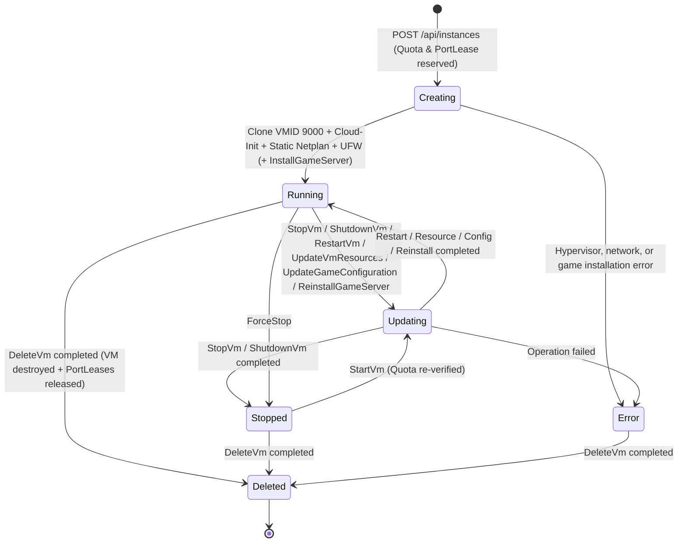

# 01. Platform Overview

## 1. Vision & Problem Statement

Provisioning and maintaining dedicated game servers on a bare-metal hypervisor such as **Proxmox Virtual Environment (Proxmox VE)** traditionally requires significant manual effort: cloning virtual machines, configuring network leases, opening firewall ports, setting up NAT rules on the host, installing runtime dependencies (Java, 32-bit libraries, SteamCMD), configuring systemd services, and managing backups. Furthermore, sharing a Proxmox node among multiple friends, community moderators, or tenants directly through the Proxmox web interface is complex and error-prone.

**Playmox** solves this by acting as a purpose-built, self-hosted **Multi-Tenant Game Server Control Plane** on top of Proxmox VE:
- **Complete Hypervisor Abstraction**: End users never interact with the Proxmox web UI or hypervisor API directly. All operations flow through Playmox's REST and WebSocket endpoints.
- **Full KVM Isolation**: Unlike shared container panels where noisy neighbors or kernel exploits can impact other servers, Playmox provisions each instance as a dedicated **KVM Virtual Machine** cloned from an Ubuntu 24.04 LTS Cloud-Init template.
- **Automated Game Server Lifecycle**: Powered by **LinuxGSM** and custom `IGameServerConnector` implementations, Playmox installs, updates, configures, monitors, backs up, and restores dedicated game servers automatically over SSH/SFTP.

---

## 2. User Roles & Capabilities

Playmox enforces role-based access control (`User` and `Admin`) backed by per-user resource quotas (`UserQuota`).

### Standard User (`User`)
- **Quota Dashboard**: View real-time consumption and limits for CPU cores, RAM, Disk storage, active instance count, and public ports.
- **Self-Service VM & Game Provisioning**: Spin up new KVM virtual machines running **Minecraft Java**, **Terraria**, **Unturned**, **Factorio**, or a **Blank VM** (`Ubuntu 24.04`) within assigned quota limits.
- **Instance Power & Resource Control**: Start, gracefully shut down, restart, force-stop, resize CPU/RAM/Disk, or delete owned instances.
- **Dynamic Game Configuration**: Edit game settings through automatically generated UI forms (backed by JSON Schema) or add custom configuration key-value pairs (`customParameters`), with one-click live reload from the guest VM's configuration files.
- **Live Installation Stream & Steam Guard Support**: Monitor real-time terminal output during game installation or reinstallation, including prompts for **Steam Guard Mobile Authenticator** confirmation when using personal Steam credentials.
- **One-Click Backups & Restore**: Download `.tar.gz` archives of world saves and server configuration files, or upload an archive to restore a server state.
- **WebSocket SSH Console & Password Reset**: Open an interactive SSH session (`gameserver` user) directly inside the browser or connect via an external SSH client on the allocated public SSH port, and rotate the VM password at any time.

### Administrator (`Admin`)
Includes all standard user capabilities, plus:
- **Global Instance Visibility**: View, inspect, control, configure, and troubleshoot virtual machines belonging to all users across the platform.
- **User & Quota Management (`/admin/users`)**: Create and delete user accounts, and dynamically adjust each user's CPU, RAM, Disk, Max Instances, Max Public Ports, and Public SSH port permissions.
- **Proxmox Infrastructure Configuration (`/configuration`)**: Configure the Proxmox VE API endpoint, node name, API token credentials, template VMID (`9000`), target storage pool, network bridge, and external public address, or download the Proxmox host bootstrap script.
- **Proxmox Host Telemetry**: Monitor real-time Proxmox node CPU, RAM, storage utilization, and hypervisor health from the dashboard.
- **VM Diagnostics**: Query low-level Proxmox and QEMU Guest Agent diagnostic snapshots for any VM.

---

## 3. Lifecycle of a Game Server Virtual Machine

### Resource Quota Accounting Across States
Playmox uses smart quota accounting (`InstanceLifecycleService`) so users can maintain multiple game worlds without exhausting host compute resources:
- **Active VMs (`Creating`, `Running`, `Updating`)**: Count toward **CPU Cores**, **RAM (MB)**, **Disk (GB)**, **Active Instances**, and **Public Ports** quotas.
- **Stopped VMs (`Stopped`)**: Only count toward the user's **Disk (GB)** quota (while retaining their reserved port bindings in `PortLeases`). CPU, RAM, instance slot, and active public port quotas are reclaimed while the VM is powered off, and are automatically re-validated before allowing the user to start the VM again.
