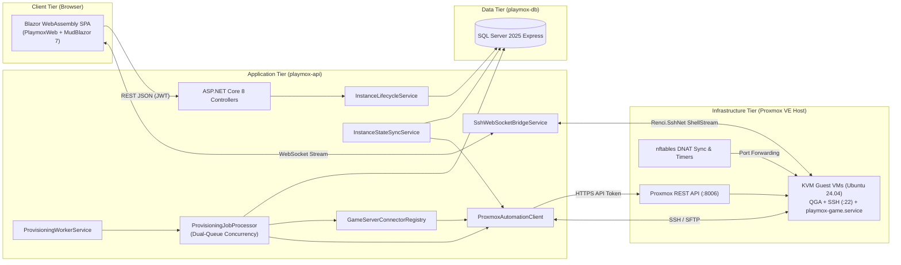

# 02. System Architecture

## 1. High-Level Architectural Design

Playmox is structured as a three-tier containerized application (`playmox-frontend`, `playmox-api`, `playmox-db`) that orchestrates a **Proxmox VE 8.x** hypervisor and its guest KVM virtual machines over HTTPS REST, QEMU Guest Agent (QGA), and SSH/SFTP.

---

## 2. Backend Core Components (`API/`)

### 2.1 REST Controllers & Middleware
- **Controllers (`API/Controllers/`)**: Expose strongly-typed endpoints for authentication (`AuthController`), virtual machine & game lifecycle (`InstancesController`), job tracking (`ProvisioningJobsController`), game catalog (`GameDefinitionsController`), user & quota administration (`UsersController`), Proxmox node settings/telemetry (`ProxmoxSettingsController`, `ProxmoxDashboardController`, `ProxmoxDiagnosticsController`), and host bootstrap script delivery (`BootstrapController`).
- **Error Handling (`PrettyErrorMiddleware`)**: Normalizes unhandled exceptions and validation errors into structured `ApiError` JSON payloads (`Status`, `Error`, `Message`, `Path`).
- **Authentication**: Stateless JWT Bearer authentication (`TokenService`) paired with refresh token rotation stored in `UsersTokens`. WebSocket and file download endpoints also accept `?access_token=` query tokens when browser APIs cannot set custom `Authorization` headers.

### 2.2 `InstanceLifecycleService`
Acts as the primary domain orchestrator (`API/Services/Platform/InstanceLifecycleService.cs`):
- Enforces multi-tenant ownership and administrator overrides.
- Calculates real-time resource usage against `UserQuota` (enforcing the rule that stopped VMs only consume disk quota).
- Allocates unique Proxmox `VmId` numbers and collision-free public ports in the `PortLeases` table (`22000`–`32000`).
- Enqueues asynchronous `ProvisioningJob` records with idempotency support (`IdempotencyKey`) and per-instance active job locking.
- Handles synchronous interactive operations such as live runtime queries (`GetGameRuntimeInfoAsync`), configuration snapshots (`GetGameConfigurationAsync`), live installation stream reading (`GetLiveCommandStreamAsync`), and SFTP `.tar.gz` backup creation/restoration.

### 2.3 Background Workers & Dual-Lane Concurrency

#### `ProvisioningWorkerService` & `ProvisioningJobProcessor`
All long-running hypervisor and guest operations execute asynchronously in the background via `ProvisioningWorkerService` (`BackgroundService`), which runs dedicated polling loops (every 2 seconds when idle) and dispatches work to `ProvisioningJobProcessor`.

To maximize throughput without overloading Proxmox storage or cloning locks, `ProvisioningWorkerService` and `ProvisioningJobProcessor` implement a **dual-lane concurrency model** (`JobProcessingLane`):
1. **`JobProcessingLane.Proxmox` (Globally Serialized — 1 Worker)**:
   - Operations: `CreateVm`, `StartVm`, `StopVm`, `ShutdownVm`, `RestartVm`, `DeleteVm`, `UpdateVmResources`, `ResetVmPassword`.
   - Only one hypervisor-level Proxmox operation runs at a time across the entire platform, preventing storage lock contention during disk cloning or resizing.
2. **`JobProcessingLane.VmScoped` (Parallelized Across VMs — `VmLaneWorkers = 3`)**:
   - Operations: `InstallGameServer`, `ReinstallGameServer`, `UpdateGameConfiguration`.
   - Up to 3 game provisioning jobs execute concurrently across different VMs via SSH/SFTP. Job claiming uses a `Serializable` SQL transaction (`ClaimNextQueuedJobAsync`) combined with the filtered unique index `UX_ProvisioningJobs_ActivePerInstanceAndStatus` to guarantee that a single VM never runs two conflicting jobs simultaneously.
   - Failed jobs support automatic exponential backoff retries (`DefaultMaxRetries = 3`) and transition affected instances to `VirtualInstanceStatus.Error` (with automatic compensation cleanup if `CreateVm` fails).

#### `InstanceStateSyncService`
A background `BackgroundService` running every **2 minutes** (`TimeSpan.FromMinutes(2)`) that queries the Proxmox node for live VM states and reconciles them with `VirtualGameInstances` in SQL Server:
- Skips any instance that currently has a `Queued` or `Running` provisioning job.
- Marks the instance as `Error` if the VM no longer exists on the Proxmox node (`VmExistsAsync`).
- Synchronizes the instance status (`Running`, `Stopped`, or `Error`) with the actual Proxmox VM power state.
- Queries QEMU Guest Agent (`TryGetVmGuestIpv4Async`) to keep `InternalIp` up to date and automatically pins the guest's DHCP IPv4 lease as a static Netplan configuration (`TryPinGuestDhcpAddressAsStaticAsync`, `/etc/netplan/70-playmox-static.yaml`) once the VM has been up for at least 4 minutes.

### 2.4 `ProxmoxAutomationClient`
Encapsulates all communication with the Proxmox VE host and guest VMs (`API/Services/Proxmox/ProxmoxAutomationClient.cs`):
- **Proxmox REST API**: Authenticates with `Authorization: PVEAPIToken=<user>!<tokenId>=<secret>`, manages template cloning, Cloud-Init parameters, CPU/RAM/Disk resizing, power actions (`start`, `stop`, `shutdown`, `reboot`), and UPID task polling.
- **QEMU Guest Agent (QGA)**: Queries `/agent/network-get-interfaces` to discover the guest VM's internal IPv4 address and `/agent/exec` for out-of-band guest commands (such as emergency password resets or static IP configuration when SSH is not yet reachable).
- **SSH & SFTP (`Renci.SshNet`)**: Executes non-interactive provisioning scripts, streams real-time installation logs into an in-memory ring buffer (`LiveCommandStream`), and uploads/downloads configuration and backup archives.

### 2.5 `SshWebSocketBridgeService`
Bridges browser WebSocket connections (`GET /api/ws/instances/{id}/ssh`) directly to an interactive `Renci.SshNet` `ShellStream` (`xterm-256color`, 120×36) on the target guest VM's internal IPv4 address (`port 22`). Supports live terminal resize messages (`{"type":"resize","cols":...,"rows":...}`) and bidirectional UTF-8 streaming without exposing any third-party web terminal daemon on the guest VM.

---

## 3. Frontend Architecture (`Frontend/PlaymoxWeb/`)

The frontend is a standalone **Blazor WebAssembly** Single Page Application served by Nginx (`playmox-frontend`):
- **UI Framework**: Built on **MudBlazor 7.x**, featuring responsive cards, dialogs, data tables, and custom Dark/Light palettes (`ThemeService`).
- **Dynamic Form Engine (`DynamicConfigService`)**: Parses each `GameDefinition.JsonSchema` at runtime to render appropriate inputs (text fields, numeric sliders/inputs with min/max validation, boolean switches, enum dropdowns) alongside a dynamic key-value editor for `customParameters`.
- **Internationalization (`LocalizationService` + `Tr.cs`)**: Full bilingual support (**English** and **Polish**) backed by external JSON dictionaries (`wwwroot/locales/en.json`, `wwwroot/locales/pl.json`), strongly-typed `Tr` keys with IDE IntelliSense, and language persistence in `localStorage` and cookies (`playmox_lang`).
- **Interactive Onboarding (`TutorialService` + `wwwroot/js/tutorial.js`)**: A 14-step guided spotlight tour that walks new users through quotas, instance creation, power controls, game configuration, backups, and SSH access.
