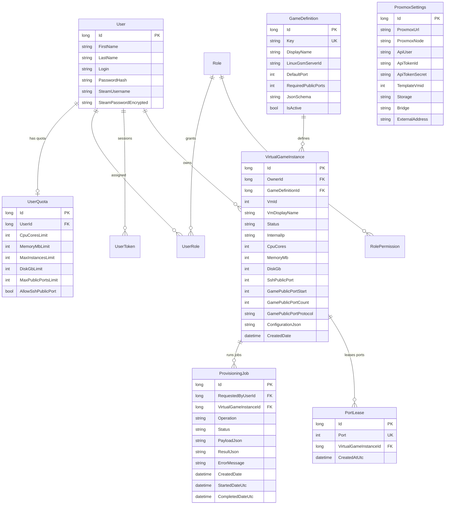

# 06. Data Model, Resource Quotas & Dynamic Parameters

Playmox uses **Entity Framework Core 9.0** with **Microsoft SQL Server 2025 Express** (`PlaymoxContext` in `API/BLL/PlaymoxContext.cs`). Database migrations run automatically on API startup (`dbContext.Database.Migrate()`), followed by idempotent bootstrap data seeding (`BootstrapDataSeeder.SeedInitialData`).

---

## 1. Entity-Relationship Diagram

---

## 2. Core Platform Entities (`API/BLL/BO/Platform/`)

### 2.1 `GameDefinition`
Stores the catalog of available server types seeded by `BootstrapDataSeeder.cs`:
- `Key` (Unique Index): Identifier used across API requests and `GameServerKindResolver` (`blank-vm`, `minecraft-java`, `terraria`, `unturned`, `factorio`, `cs2`).
- `LinuxGsmServerId`: The LinuxGSM script identifier (`mcserver`, `terrariaserver`, `untserver`, `fctrserver`, or empty for `blank-vm`).
- `DefaultPort` & `RequiredPublicPorts`: Determines how many contiguous public ports (`PortLeases`) must be reserved when provisioning an instance (`0` for `blank-vm`, `1` for Minecraft/Terraria/Factorio, `2` for Unturned).
- `JsonSchema`: Standard JSON Schema document describing the configurable parameters for this game.

### 2.2 `VirtualGameInstance`
Represents a provisioned KVM virtual machine on Proxmox VE:
- `OwnerId` (Foreign Key to `User`): The platform user who owns and manages the instance.
- `Status` (`VirtualInstanceStatus` enum): `Creating` (1), `Running` (2), `Stopped` (3), `Updating` (4), `Deleted` (5), `Error` (6).
- `VmId`: Unique Proxmox VM identifier (`>= 100`, excluding `TemplateVmid`).
- `InternalIp`: The private IPv4 address assigned to the guest VM and discovered via QEMU Guest Agent.
- `CpuCores`, `MemoryMb`, `DiskGb`: Allocated hardware resources.
- `SshPublicPort`, `GamePublicPortStart`, `GamePublicPortCount`, `GamePublicPortProtocol`: Public port mapping metadata synchronized to the Proxmox host's `nftables` DNAT rules.
- `ConfigurationJson`: Stores a composite JSON document containing:
  - Game-specific parameters (matching `GameDefinition.JsonSchema`).
  - `customParameters`: User-defined key/value overrides applied to the underlying server configuration file.
  - `systemAccess`: Internal metadata (`username: "gameserver"`, AES-encrypted `passwordEncrypted`, `internalIp`, and optional `steamUsername` / `steamPasswordEncrypted`).
  - `network`: Allocated public port summary.

### 2.3 `ProvisioningJob`
Tracks asynchronous background tasks executed by `ProvisioningJobProcessor`:
- `RequestedByUserId` (Foreign Key to `User`): The user who initiated the operation.
- `VirtualGameInstanceId` (Nullable Foreign Key): The instance target (nullable for platform-wide operations).
- `Operation` (`ProvisioningOperation` enum): `CreateVm` (1), `StartVm` (2), `StopVm` (3), `RestartVm` (4), `DeleteVm` (5), `UpdateVmResources` (6), `ResetVmPassword` (7), `ShutdownVm` (8), `InstallGameServer` (9), `ReinstallGameServer` (10), `UpdateGameConfiguration` (11).
- `Status` (`ProvisioningJobStatus` enum): `Queued` (1), `Running` (2), `Succeeded` (3), `Failed` (4).
- `PayloadJson` & `ResultJson`: Serialized task parameters (such as resource resizing deltas or game config updates) and execution output.
- **Database-Level Concurrency Protection**: A filtered unique index `UX_ProvisioningJobs_ActivePerInstanceAndStatus` (`WHERE VirtualGameInstanceId IS NOT NULL AND Status IN ('Queued', 'Running')`) guarantees that at most one active job can exist per VM instance at any time.

### 2.4 `UserQuota` & Resource Accounting Rules
Each user has a `UserQuota` record defining their maximum allowed resources:
- **Active Compute VMs (`Creating`, `Running`, `Updating`)** consume:
  - `CpuCoresLimit`
  - `MemoryMbLimit`
  - `MaxInstancesLimit`
- **Disk Quota VMs (`Creating`, `Running`, `Stopped`, `Updating`)** consume:
  - `DiskGbLimit`
- **Stopped VMs (`Stopped`)** consume **only `DiskGbLimit`** (and keep their allocated ports reserved). Their CPU, RAM, and active instance slots are freed while powered off, allowing users to keep multiple configured game worlds on disk and switch between them. Starting a stopped VM (`POST /api/instances/{id}/start`) re-verifies that starting the VM will not exceed the user's CPU, RAM, or active instance limits.

---

## 3. Dynamic Game Configuration (`JsonSchema` + `customParameters`)

Playmox avoids hardcoding per-game configuration forms in the frontend. Instead:
1. **Schema-Driven Form Rendering**: When a user opens the **Create Instance** dialog or **Game Configuration** dialog, `DynamicConfigService` (`Frontend/PlaymoxWeb/Services/DynamicConfigService.cs`) parses `GameDefinition.JsonSchema` and dynamically builds MudBlazor form controls:
   - `"type": "string"` with `"enum"` -> `MudSelect` dropdown
   - `"type": "string"` -> `MudTextField`
   - `"type": "integer"` -> `MudNumericField` enforcing `minimum` and `maximum` bounds
   - `"type": "boolean"` -> `MudSwitch`
2. **Custom Parameters (`customParameters`)**: Alongside schema-defined fields, users can add arbitrary key-value pairs in the UI. During installation or configuration updates, `GameServerCustomParameters` (`API/Services/Platform/Games/`) safely sanitizes and upserts these parameters directly into the native game configuration file:
   - `BuildIniUpsertScript`: Upserts `key=value` lines into `server.properties` (Minecraft) or `serverconfig.txt` (Terraria).
   - `BuildSpaceSeparatedUpsertScript`: Upserts `key value` directives into `Commands.dat` (Unturned).
   - `BuildFactorioJsonUpsertScript`: Upserts JSON properties into `server-settings.json` via `jq` (Factorio).
3. **Two-Way Configuration Sync (`source=db` vs. `source=live`)**:
   - Calling `GET /api/instances/{id}/game/config?refresh=false` returns the configuration snapshot stored in SQL Server (`source = "db"`).
   - Calling `GET /api/instances/{id}/game/config?refresh=true` connects to the running guest VM via SSH, parses the actual on-disk configuration file (`server.properties`, `serverconfig.txt`, `Commands.dat`, or `server-settings.json`), merges any manual edits back into `VirtualGameInstance.ConfigurationJson`, and returns `source = "live"`.
