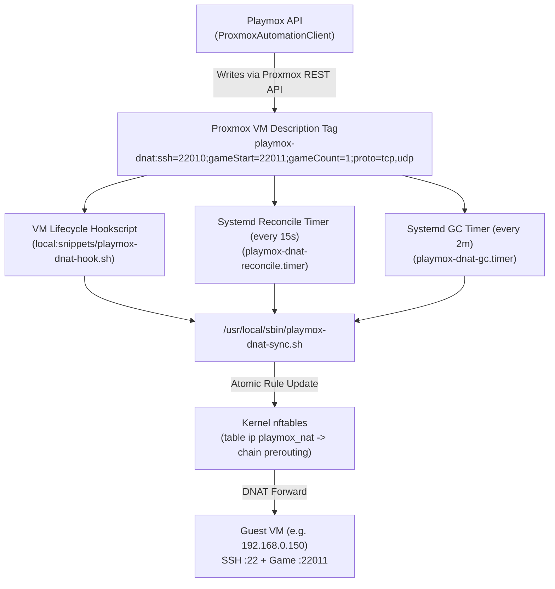

# 07. Networking, Host DNAT & Security Architecture

Playmox provides automated public port allocation, host-level `nftables` DNAT port forwarding on Proxmox VE, guest VM firewalling, and cryptographic protection for stored secrets.

---

## 1. Public Port Allocation (`PortLeases`)

Because multiple users share a single public IPv4 address on the Proxmox VE host, Playmox dynamically leases ports from the range **`22000`–`32000`**:
- **SSH Public Port**: If the user's quota has `AllowSshPublicPort = true` and the user enables public SSH access on the instance, Playmox allocates 1 TCP port (e.g., `22010`) that forwards to port `22` inside the guest VM.
- **Game Public Ports**: Playmox allocates `GameDefinition.RequiredPublicPorts` **contiguous** ports (`GamePublicPortStart` through `GamePublicPortStart + GamePublicPortCount - 1`). For example, Unturned requires 2 contiguous ports (e.g., `22011` and `22012`), which are mapped both on the host DNAT and inside the guest server configuration so Steam query port calculation (`GamePort + 1`) works seamlessly.
- **Atomic Reservation**: Every allocated port is inserted into the `PortLeases` SQL table, which enforces a unique index (`IX_PortLeases_Port`) and a foreign key to `VirtualGameInstances` (`ON DELETE CASCADE`). Before finalizing a lease, Playmox also checks all existing VM descriptions on the Proxmox node to avoid collisions with externally managed rules.

---

## 2. Proxmox Host DNAT Pipeline (`nftables`)

Playmox never requires SSH root access from the API container to the Proxmox host at runtime. Instead, it uses a declarative metadata mechanism backed by scripts installed during host bootstrap (`bootstrap-playmox-proxmox.sh`).



### 2.1 Declarative VM Description Tag
Playmox encodes the instance's port forwarding specification into the VM's Proxmox `description` field:

```text
playmox-dnat:ssh=22010;gameStart=22011;gameCount=1;proto=tcp,udp
```

- **SSH Port Forwarding**: Public `ssh` (`22010/tcp`) is translated (`dnat to`) `<guest_ip>:22`.
- **Game Port Forwarding**: Public ports `gameStart`..`gameStart + gameCount - 1` (`22011/tcp,udp`) are translated (`dnat to`) `<guest_ip>:<same_port>`.

### 2.2 Synchronization Mechanisms on the Proxmox Host
`bootstrap-playmox-proxmox.sh` installs three cooperating components on the Proxmox host:
1. **`/usr/local/sbin/playmox-dnat-sync.sh`**:
   - Reads the `playmox-dnat:ssh=...` line from `qm config <vmid>`.
   - If the VM is `running` and has a valid private `guest_ip` (queried via QEMU Guest Agent `qm guest cmd <vmid> network-get-interfaces`), it adds/updates rules in `nftables` (`table ip playmox_nat`, `chain prerouting`) tagged with comments `playmox-vm-$VMID-ssh-$DNAT_SSH_PORT` and `playmox-vm-$VMID-game-$proto-$port`.
   - Uses per-VM flock locks (`/run/playmox/dnat-sync-${VMID}.lock`) so multiple VMs synchronize concurrently without race conditions.
2. **Proxmox Hookscript (`local:snippets/playmox-dnat-hook.sh`)**:
   - Triggered immediately on `post-start` and `pre-stop` VM lifecycle events when attached to a VM.
3. **Systemd Timers (`playmox-dnat-reconcile.timer` & `playmox-dnat-gc.timer`)**:
   - **`playmox-dnat-reconcile.timer`** runs every **15 seconds**, scanning all `running` VMs in parallel and applying any updated DNAT tags. This guarantees DNAT works even if the Proxmox API token does not have permission to attach hookscripts.
   - **`playmox-dnat-gc.timer`** runs periodically every **1 minute** (`OnUnitActiveSec=1min`) to remove orphaned `nftables` rules belonging to stopped or deleted VMs.

---

## 3. Guest VM Network & Firewall Security

1. **Static IP Pinning via Netplan**: After first boot, Playmox converts the guest VM's DHCP lease into `/etc/netplan/70-playmox-static.yaml` (`dhcp4: false`). This prevents internal IP changes that could otherwise cause DNAT traffic to route to the wrong guest.
2. **UFW Default-Deny Policy**: Each guest VM has `ufw` enabled with `default deny incoming`, opening only port `22/tcp` and the allocated game ports.
3. **Unprivileged Game Execution**: Game servers and LinuxGSM scripts run exclusively under the unprivileged `gameserver` account (`/home/gameserver`), never as `root`.

---

## 4. Application & Credential Security

- **Password Hashing**: User passwords in SQL Server (`Users.PasswordHash`) are hashed using Argon2id (`Isopoh.Cryptography.Argon2`) salted with `Security:PasswordSalt`.
- **At-Rest Secret Encryption (`SecureSecret`)**: Sensitive secrets stored in the database—including the Proxmox API Token Secret (`ProxmoxSettings.ApiTokenSecret`), guest VM SSH passwords (`ConfigurationJson.systemAccess.passwordEncrypted`), and user Steam passwords (`Users.SteamPasswordEncrypted`)—are encrypted using AES-256 derived from `Security:AppSecret` (`enc:v1:...`).
- **Least-Privilege Proxmox API Token**: Playmox communicates with Proxmox using a dedicated service account (`playmox-svc@pve!playmox-api`) restricted to the `PlaymoxProvisioner` role rather than `root@pam`.
- **JWT & WebSocket Authorization**: Every REST endpoint and the `/api/ws/instances/{id}/ssh` WebSocket endpoint verifies user ownership (`instance.OwnerId == currentUserId || isAdmin`) before executing any action or opening an SSH bridge.
